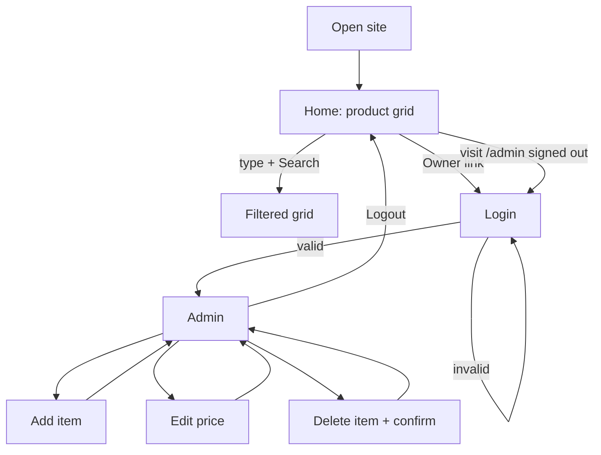

# Shop Price Checker: Design Brief (v2, frontend-first)

Internal price-lookup web app for a grocery/supermarket. Staff-facing catalogue + owner-only admin.
**Scope of this phase: frontend only.** The backend is being built by a separate developer; this project ships against a simulated backend and is integrated later through a fixed service contract (§5).
Stack: React + Vite + Tailwind CSS + shadcn/ui (custom-themed). Palette from "Honey Bond / Bare Love".

---

## 1. PRD (Product Requirements)

### 1.1 Problem
Attendants don't always know an item's current price, and the owner changes prices regularly. Staff need a fast, reliable lookup; the owner needs a simple way to keep it current.

### 1.2 Users
| Role | Access | Needs |
|---|---|---|
| Attendant | Catalogue (no login) | Search an item, read price/specs quickly on a phone or till-side tablet |
| Owner | Catalogue + Admin (login) | Add item, change price, delete item, upload photo |

### 1.3 Goals
- Find any item's price in under 5 seconds.
- Owner can change a price in under 15 seconds.
- Zero training required.

### 1.4 User stories
1. As an attendant, I search "rice" and see matching cards with price and specs.
2. As an attendant, I can browse the full list when I don't know the name.
3. As the owner, I log in with email/password.
4. As the owner, I edit a price inline and save.
5. As the owner, I add a new item with image, specs and price.
6. As the owner, I delete an item after a confirmation.
7. As the owner, I log out.

### 1.5 Functional requirements
| ID | Requirement | Priority |
|---|---|---|
| F1 | Navbar: brand, search input + search button, Owner login / Admin / Logout | Must |
| F2 | Product grid of cards: image, name, description (quantity, weight, size, colour), price | Must |
| F3 | Search filters by name, description, colour, size, weight, quantity (case-insensitive) | Must |
| F4 | Login page (owner only; no public sign-up) | Must |
| F5 | Protected `/admin` route | Must |
| F6 | Add / edit price / delete product | Must |
| F7 | Image selection with preview in the add form | Must |
| F8 | Loading (skeleton), empty and error states for every data view | Must |
| F10 | Category filter, low-stock flag, last-updated stamp | Could |

### 1.6 Non-functional requirements
- Loads < 2s on 3G-class connections; images lazy-loaded.
- Responsive: 360px phone → desktop.
- WCAG AA contrast (honey/cream pairs need dark ink text; see §3.1).
- Swapping mock → real backend must require **no changes to components or pages**, only to the service layer.

### 1.7 Out of scope (this phase)
Backend implementation (database, auth server, storage, security policies, hosting of the API). Also: checkout/cart, customer accounts, multi-owner roles, stock counting, barcode scanning, multi-branch.

### 1.8 Success metrics
Owner and attendants can complete all user stories in the preview with no guidance; backend developer can integrate by implementing the contract in §5 alone.

---

## 2. TRD (Technical Requirements, frontend)

### 2.1 Stack
- React 18 + Vite, JavaScript (TS optional; contract in §5 is written as TS types for clarity)
- react-router-dom v6
- Tailwind CSS v4 (`@tailwindcss/vite`) + **shadcn/ui** (copy-in components, Radix primitives)
- lucide-react icons, `sonner` toasts
- `react-hook-form` + `zod` for the add-item form (shadcn `Form` pattern)
- Hosting: any static host (Vercel/Netlify) for previews

### 2.2 Architecture
```
Browser (React SPA)
  ├─ Pages: Home, Login, Admin
  ├─ AuthContext (session state)
  └─ services/ (the only layer that talks to a "backend")
        └─ api/    real implementation by backend dev                      ← plugged in later
        index.js picks one via VITE_USE_MOCK (default true)
```
Components never import a backend SDK directly. They call `productsApi` / `authApi`.

### 2.3 Setup (project not created yet)
```bash
npm create vite@latest shop-price-checker -- --template react
cd shop-price-checker && npm i
npm i react-router-dom lucide-react sonner react-hook-form zod @hookform/resolvers
npm i tailwindcss @tailwindcss/vite
npx shadcn@latest init            # style: new-york, base colour: neutral, CSS variables: yes
npx shadcn@latest add button input textarea label card badge table \
  alert-dialog dialog form skeleton separator sonner sheet
```
Add the `@` path alias (`vite.config.js` + `jsconfig.json`) as the shadcn init prompts.

### 2.4 Folder structure
```
src/
├─ main.jsx, App.jsx, index.css        (theme tokens live in index.css)
├─ components/
│  ├─ ui/                shadcn primitives (generated)
│  ├─ Navbar.jsx
│  ├─ ProductCard.jsx    (custom, built from shadcn Card + Badge)
│  ├─ ProductGrid.jsx    (grid + skeleton/empty/error states)
│  ├─ PriceEditor.jsx    (inline price edit used in admin rows)
│  ├─ ProductForm.jsx
│  ├─ DeleteDialog.jsx
│  └─ ProtectedRoute.jsx
├─ pages/                Home.jsx, Login.jsx, Admin.jsx
├─ context/              AuthContext.jsx
├─ services/
│  ├─ index.js           exports { productsApi, authApi }
│  ├─ contract.md/.d.ts  the integration contract (§5)
```


### 2.6 Environment
```
# added by the backend developer at integration time:
# VITE_API_URL=
```

### 2.7 Error handling
Every service function returns a resolved value or throws `ApiError { code, message }`. Pages catch and render inline error UI + a `sonner` toast. Destructive actions use `AlertDialog`.


---

## 3. UI/UX Design Brief

### 3.1 Colour palette → shadcn theme tokens
| Token | Hex | Source |
|---|---|---|
| `--background` | `#FAF3EB` | Bare Love |
| `--primary` | `#FFA757` | Honey Bond |
| `--primary-foreground` | `#2B1B0E` | added ink (white on honey fails AA) |
| `--foreground` | `#2B1B0E` | added ink |
| `--card` | `#FFFFFF` | |
| `--secondary` | `#FAF3EB` | Bare Love (chips, subtle fills) |
| `--accent` / `--ring` | `#E8832A` | added honey-deep (hover, focus) |
| `--muted-foreground` | `#6B5744` | added |
| `--border` / `--input` | `rgba(43,27,14,.15)` | |
| `--destructive` | `#B3261E` | added |
| `--radius` | `1.25rem` | large rounded corners from the reference |

**Contrast:** honey text on cream ≈ 1.75:1 (fails WCAG). Honey is a *surface/accent*; ink is the *text* colour (ink on honey ≈ 8.8:1, on cream ≈ 15:1). Use `bg-primary text-primary-foreground` for buttons and price pills; never honey-coloured text on cream.

Dark mode: not in this phase.

### 3.2 Typography
- Display (headings, brand, prices): **Bebas Neue**, uppercase, via `font-display` utility.
- Body/UI: **Archivo** 400/500/700, set as shadcn's `font-sans`.

### 3.3 Custom UI design (on top of shadcn)
shadcn supplies accessible primitives; the look is custom:
- **Honey header + cream sheet:** navbar sits on a honey band; page content is a cream sheet with a 32px top radius overlapping it (from the reference image).
- **Pill geometry:** search input, search button, price tag and chips are fully rounded; cards and panels use `rounded-[var(--radius)]`.
- **Flat with one hover lift:** no heavy shadows; cards get a soft shadow + 2px lift on hover.
- **Price pill:** honey fill, ink Bebas numerals, bottom-right of the card.
- **Fallback image tile:** honey tile with the product's first letter in Bebas when no image.
- Restyle shadcn `Button` with a `ink` variant (ink background, cream text) for primary actions on honey, and a `honey` default elsewhere.

### 3.4 Screens
**Home (`/`)**
- Navbar: brand left; centre search input + **Search** button; right: "Owner" link (or Admin + Logout).
- Title row: "ALL ITEMS" + live result count (`aria-live`).
- Grid: 1 col (<540px) → 2 (≥540) → 3 (≥900) → 4 (≥1200).
- States: 8 skeleton cards while loading; "No items match 'xyz'" empty state with a clear-search button; error state with Retry.

**Product card** (shadcn `Card` + `Badge`)
```
┌───────────────────┐
│     [ image ]     │  4:3, cover, fallback tile
│ NAME              │  Bebas 26px
│ description text  │  2-line clamp
│ [12 pack][5 kg]   │  Badge chips: quantity · weight
│ [Large][White]    │  size · colour (hidden if empty)
│            GH₵ 85 │  price pill
└───────────────────┘
```

**Login (`/login`):** centred `Card` on the honey background; email + password (`Form`), Sign in, inline error, back link. 

**Admin (`/admin`):**
1. "Add item" card: `Form` with name, price, description, quantity, weight, size, colour, image picker with live preview; zod validation messages under fields.
2. Items `Table` (desktop) / stacked rows (mobile): thumbnail, name, current price, inline price input + Save (disabled until changed), Delete (opens `AlertDialog`).
3. Footer: 
- Feedback via `sonner` toasts: "Price updated", "Item added", "Item deleted".

### 3.4.1 Preview states to design and review
Loading skeletons · empty catalogue · no search results · API error with retry · login error · add-item validation errors · delete confirmation · saving (button spinner) · success toast.

### 3.5 Interaction
- Search is live (debounced 200 ms) and also submits via the button; URL keeps `?q=` so searches are shareable.
- Optimistic UI for price edit with rollback on error.
- Focus ring: 3px `--ring`.

### 3.6 Accessibility
Labels on every input, `aria-live` for result counts and errors, 44px min touch targets, alt text = product name, full keyboard operation (Radix handles dialog focus trapping).

---

## 4. App Flow



| Path | Access | Page |
|---|---|---|
| `/` | Public | Home |
| `/login` | Public (redirects to /admin if signed in) | Login |
| `/admin` | Owner only (client-side guard) | Admin |
| `*` | Public | Redirect to `/` |

---

## 5. Integration Contract (what the backend developer implements)

The frontend depends only on these two modules.

```ts
type Product = {
  id: string
  name: string
  description: string
  quantity: string      // free text, e.g. "12 pack"
  weight: string        // e.g. "5 kg"
  size: string          // e.g. "Large"
  colour: string        // e.g. "White"
  price: number         // 2-dp, >= 0
  image_url: string     // absolute URL or ''
  created_at?: string   // ISO
  updated_at?: string   // ISO
}

type NewProduct = Omit<Product, 'id' | 'created_at' | 'updated_at'>

interface ProductsApi {
  list(): Promise<Product[]>                                  // public, sorted by name
  create(p: NewProduct): Promise<Product>                     // owner only
  updatePrice(id: string, price: number): Promise<Product>    // owner only
  remove(id: string): Promise<void>                           // owner only
  uploadImage(file: File): Promise<string>                    // owner only → returns image URL
}

interface AuthApi {
  getSession(): Promise<{ email: string } | null>
  signIn(email: string, password: string): Promise<{ email: string }>   // throws ApiError on failure
  signOut(): Promise<void>
  onChange?(cb: (session: { email: string } | null) => void): () => void // optional
}

class ApiError extends Error { code: string }   // e.g. 'INVALID_CREDENTIALS', 'NETWORK', 'FORBIDDEN', 'VALIDATION'
```
Notes for integration: reads are public; writes require the owner session; the frontend already shows error states for `NETWORK`, `FORBIDDEN` and `INVALID_CREDENTIALS`. Anything beyond this contract (storage choice, auth provider, policies) is the backend developer's decision.

---

## 6. Implementation Plan (frontend only)

| Phase | Deliverable |
|---|---|
| 1. Scaffold | Vite app, Tailwind, shadcn init, fonts, theme tokens in `index.css`, router shell |
| 3. Catalogue | Navbar + search, `ProductCard`, `ProductGrid` with skeleton/empty/error states |
| 4. Auth | `AuthContext`, Login page, `ProtectedRoute` |
| 5. Admin | Add form (zod), inline price edit, delete dialog, toasts, reset demo data |
| 6. Polish | Responsive pass at 360 / 768 / 1280, a11y pass, contrast check |
| 7. Preview release | Deploy static preview for stakeholder review |
| 8. Integration (later, with backend dev) |  add `services/api/*` implementing §5, smoke-test every user story |

### Acceptance checklist (preview)
- [ ] Search narrows results by name/desc/colour/size/weight/quantity
- [ ] Card shows image, name, description, quantity/weight/size/colour, price
- [ ] `/admin` redirects when signed out; wrong password shows error
- [ ] Add, price edit and delete work 
- [ ] Skeleton, empty, error and validation states are all reachable 
- [ ] Usable at 360px width; AA contrast on all text
- [ ] No component imports anything outside `services/` for data
